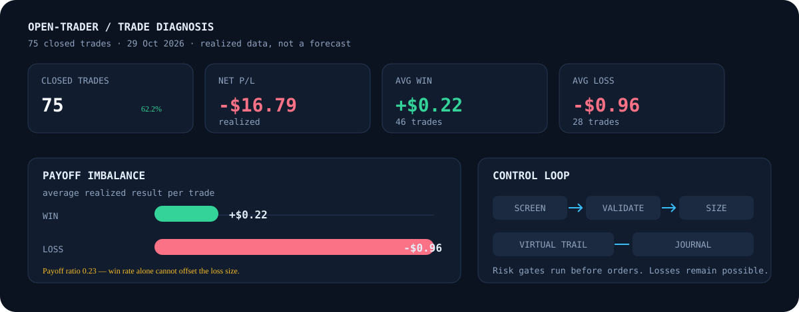

# Trade analysis

> **Historical diagnosis, not a forecast.** The sample below describes 75 closed
> trades recorded on 29 October 2026. It does not establish that subsequent code
> changes improve returns. Trading can lose money; validate changes on demo.

  

## Observed results

| Metric | Observed |
| --- | ---: |
| Closed trades | 75 |
| Wins / losses / flat | 46 / 28 / 1 |
| Win rate, excluding flat | 62.2% (46 / 74) |
| Net realized P/L | **−$16.79** |
| Average winning trade | +$0.22 |
| Average losing trade | −$0.96 |
| Payoff ratio, avg win / abs(avg loss) | **0.23** |

Rounded trade averages do not reproduce the exact net total: the trade-level
results carry more precision than the displayed two-decimal averages. Using the
rounded values gives +$10.12 across wins and −$26.88 across losses (−$16.76
combined), a $0.03 rounding difference from the recorded −$16.79.

## What the sample suggests

The win rate was positive, but average losses were about 4.4 times the average
win. At this payoff ratio, a high win rate by itself was not enough to produce a
positive result. The realized journal also showed repeated same-symbol entries,
including 11 SELL opens each for XAUUSD and XAUUSD247. This indicates repeated
exposure; it does not by itself prove that those entries caused a specific share
of the net loss.

The journal does not retain enough per-position price history to reconstruct
maximum favorable/adverse excursion (MFE/MAE) or replay the revised exit rules.
Therefore the following are **implementation changes**, not backtest results:

1. **Delayed profit protection** — wait for configured progress in R before
   moving the virtual stop beyond entry; the default activation is 0.5R.
2. **Risk-relative trail distance** — post-lock trailing uses peak progress in
   R, bounded by configured ATR distance and the existing trail distance.
3. **Adverse-side loss cut** — close a still-unlocked position when the tighter
   configured risk-distance or ATR threshold is reached, subject to a minimum
   distance.
4. **Correct locked-profit display** — report zero unless the virtual stop is
   beyond entry on the profitable side.
5. **Close retry matching** — normalize underscore/hyphen broker codes before
   matching already-closed responses.
6. **Symbol exposure guard** — default one open position per symbol and a five-
   minute cooldown after close.

## Risk controls now configured

| Control | Default | Interpretation |
| --- | ---: | --- |
| Profit-lock activation | `0.5R` | Progress required before the first profit lock |
| Loss cut risk bound | `35%` of R | One of two adverse-distance bounds |
| Loss cut ATR bound | `0.8 × ATR` | The tighter valid risk/ATR bound is used |
| Loss cut minimum | `2 pips` | Floors the calculated cut distance |
| Open positions per symbol | `1` | Blocks same-symbol stacking |
| Post-close cooldown | `5 minutes` | Blocks immediate symbol re-entry |

These settings are configurable through `AGENT_PROFIT_LOCK_ACTIVATE_R`,
`AGENT_LOSS_CUT_RISK_PCT`, `AGENT_LOSS_CUT_ATR`,
`AGENT_LOSS_CUT_MIN_PIPS`, `AGENT_MAX_OPEN_PER_SYMBOL`, and
`AGENT_SYMBOL_COOLDOWN_MS`. See [README configuration](README.md#configuration).

## Simulation status

**No counterfactual P/L estimate is reported.** The old rough scenarios assumed
how many winners would extend, how often the loss cut would trigger, and how
much same-symbol stacking contributed to losses. Those quantities cannot be
inferred from the available logs, so projected positive results would be
misleading.

A replayable simulation needs, at minimum, timestamped executable bid/ask per
managed position, initial risk distance, stop changes, and final realized P/L
including fees. Then apply each candidate rule to the same quote sequence,
including spread and close slippage, and compare net P/L, average win/loss,
maximum drawdown, and trade count. Until that data exists, run the new defaults
on demo and compare against a fixed baseline over a predeclared sample.

## Reproduce the sample summary

The source log was `.cache/trades/2026-10-29.jsonl`; it is local runtime data and
is not committed. Close events with a `net … USD` reason were deduplicated by
position ID. Win rate excludes the one flat trade.

**Current automated checks:** `npm test` and `npm run typecheck`. These verify
code behavior and types; neither proves profitability. Live broker behavior still
requires demo testing.
