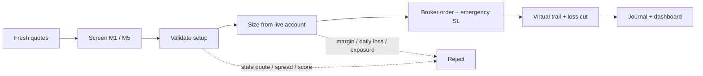
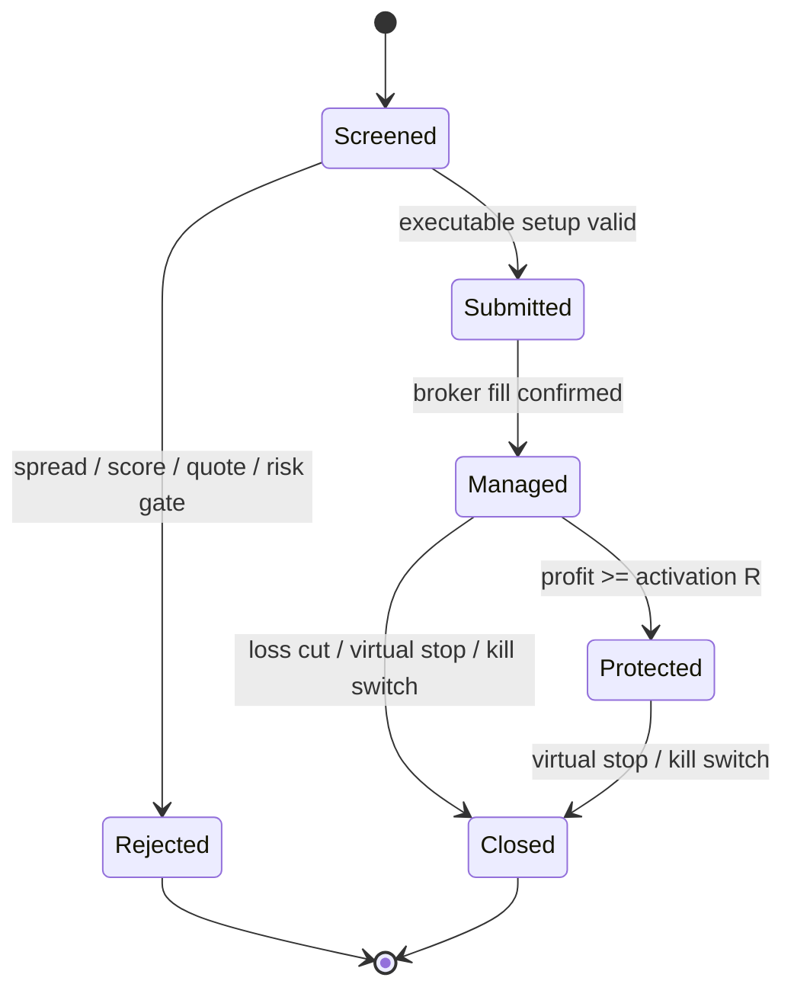

<p align="center">
  
</p>

<h1 align="center">Open-Trader</h1>

<p align="center">
  <strong>Terminal-native, risk-first trading automation for the Exness Trader API.</strong><br>
  TypeScript · Node.js 22+ · Demo-first · No LLM · Virtual trailing stop
</p>

<p align="center">
  <code>Node 22+</code>
  <code>TypeScript</code>
  <code>MIT</code>
  <code>Demo-first</code>
  <code>57 tests</code>
</p>

<p align="center">
  <a href="#quick-start">Quick start</a> ·
  <a href="#risk-model">Risk model</a> ·
  <a href="#dashboard">Dashboard</a> ·
  <a href="#configuration">Configuration</a> ·
  <a href="#analysis">Analysis</a>
</p>

> [!WARNING]
> **Experimental trading software.** Start on a demo account. Markets, spreads,
> slippage, outages, and broker execution can produce losses. Nothing here is
> financial advice, a profit claim, or a recommendation to trade.

---

## Why Open-Trader

Open-Trader is a single-process terminal trading system. It scans M1/M5 market
structure, validates executable prices, sizes positions from live account data,
and manages every account position with an emergency broker stop plus a virtual
trailing stop.

| Built for | Not built for |
| --- | --- |
| Transparent rule-based execution | Profit guarantees or black-box signals |
| Demo-account iteration | Unattended production use without monitoring |
| Fast terminal feedback | High-frequency or latency-arbitrage trading |
| Account-wide risk controls | A replacement for broker safeguards |



## Quick start

**Requirements:** Node.js 22+, an Exness Trader API key, and an Exness **demo**
account.

```bash
npm install
cp .env.example .env
# Fill EXNESS_API_KEY, EXNESS_PRIVATE_KEY, and EXNESS_ACCOUNT_ID in .env.
npm start
```

Read-only snapshot; it never opens orders:

```bash
npm start -- --once
```

Development checks:

```bash
npm test
npm run typecheck
```

> [!TIP]
> Keep the initial run small: verify access-point discovery, quotes, dashboard
> rendering, and rejection reasons before enabling any live trading mode.

## Risk model

Open-Trader treats the broker stop-loss as the crash safety net, not the normal
exit engine. The executor uses live account balance/equity, broker conditions,
free margin, aggregate risk, daily loss, current spread, and fresh executable
bid/ask prices before an order is sent.

| Guard | Default | What it blocks |
| --- | ---: | --- |
| Risk per trade | `0.1%` | Oversized single positions |
| Aggregate open risk | `2%` | Account-level overexposure |
| Daily-loss cutoff | `3%` | New entries after material daily loss |
| Free-margin reserve | `25%` + buffer | Margin exhaustion |
| Max open positions / symbol | `1` | Same-symbol stacking |
| Re-entry cooldown | `5 min` | Immediate re-entry churn |
| Quote age | `8 s` | Decisions on stale prices |
| Loss cut | `min(35% R, 0.8 × ATR)` | Losers reaching the full emergency stop |

### Trade lifecycle



<details>
<summary><strong>What happens after an entry?</strong></summary>

1. A market order is sent with a broker emergency stop-loss; no take-profit is
   sent.
2. The virtual trail starts from the actual fill, using the executable bid for
   BUYs and ask for SELLs.
3. Profit protection waits for real progress: default `0.5R`, not merely the
   spread cushion.
4. Once protected, the virtual stop only ratchets toward profit; it never
   loosens.
5. A position that never reaches protection can be closed at the adverse-side
   loss-cut threshold before the wide emergency stop is hit.
6. Every close, reject, protect, error, and trailing change is journaled.

</details>

## Dashboard

The full-screen dashboard and live agent run in one process. It shows account
health, screener/entry/trader activity, virtual and broker stops, current P/L,
and `LOCK $`: the USD profit protected beyond entry by the virtual stop.

```text
open-trader · DEMO
  BALANCE / EQUITY / FREE MARGIN / POSITIONS
  SCREENER · ENTRY · TRADER        (side-by-side containers)
  AGENT LOG
  POSITIONS                        (SL broker + TS VIRT + distance + LOCK $)
  ACCOUNT · MARKET · RISK
  EQUITY / DRAWDOWN
  EVENTS · ORDERS
```

| Key | Action |
| --- | --- |
| `q` / `Ctrl+C` | Quit dashboard and stop agent |
| `p` | Pause / resume account polling |
| `a` | Show / hide agent containers and log |
| `c` | Show / hide equity and drawdown charts |
| `o` / `e` | Show / hide orders or events |
| `r` | Force a REST snapshot refresh |
| `x`, then `y` | Persist kill switch, block entries, close all positions |
| `u` | Remove persistent kill switch |
| `↑` / `↓`, `j` / `k` | Scroll one line |
| `PgUp` / `PgDn`, `g` / `G` | Navigate dashboard history |

The kill switch lives at `.cache/KILL`. While it exists, new entries are refused
and every open account position—including externally opened positions—is closed.

## Analysis

The latest realized-book diagnosis is kept in [ANALYSIS.md](ANALYSIS.md).
It intentionally separates observed results from hypothetical impact estimates.

<p align="center">
  
</p>

The visualization is static and GitHub-renderable. It summarizes a historical
sample; it is **not** a performance forecast, live account balance, or evidence
of future profitability.

## Configuration

Create `.env` from [`.env.example`](.env.example). Never commit the private key.

```ini
EXNESS_API_KEY=exnsk-...
EXNESS_PRIVATE_KEY=...            # 128-char hex pair, 64-char seed, or PEM
EXNESS_ACCOUNT_ID=31000172947
EXNESS_DISCOVERY_URL=https://api.exness.com
```

`EXNESS_API_SECRET` remains a fallback name for the private key.
`EXNESS_ACCESS_POINT` can pin a discovered access point.

### Strategy defaults

All values are environment-overridable. Defaults target controlled demo-account
iteration, not maximized trade frequency.

| Setting | Default | Environment variable |
| --- | --- | --- |
| Scan / manage cadence | `2 s` / `1 s` | `AGENT_SCAN_INTERVAL_MS`, `AGENT_MANAGE_INTERVAL_MS` |
| Timeframes | screener `M1`, trend `M5`, confirm/trail `M1` | `AGENT_*_TF` |
| Shortlist / candidates | `20` / `20` | `AGENT_SHORTLIST`, `AGENT_MAX_CANDIDATES` |
| Risk per trade | `0.1%` | `AGENT_RISK_PCT` |
| Aggregate risk / daily cutoff | `2%` / `3%` | `AGENT_MAX_OPEN_RISK_PCT`, `AGENT_MAX_DAILY_LOSS_PCT` |
| Initial virtual trail | `max(1.2 × ATR, 4 pips)` | `AGENT_TRAIL_ATR`, `AGENT_TRAIL_MIN_PIPS` |
| Profit-lock activation | `0.5R` | `AGENT_PROFIT_LOCK_ACTIVATE_R` |
| Profit-lock cushion | spread + `0.5 pip` | `AGENT_PROFIT_LOCK_MIN_PIPS` |
| Post-lock trail | tighter ATR / risk-relative target | `AGENT_PROFIT_TRAIL_ATR`, `AGENT_PROFIT_TRAIL_MIN_PIPS` |
| Loss cut | `min(35% R, 0.8 × ATR)`, floor `2 pips` | `AGENT_LOSS_CUT_RISK_PCT`, `AGENT_LOSS_CUT_ATR`, `AGENT_LOSS_CUT_MIN_PIPS` |
| Emergency broker stop | `max(1.5 × ATR, 6 pips, 3 × spread)` | `AGENT_EMERGENCY_SL_ATR`, `AGENT_MIN_STOP_PIPS` |
| Same-symbol exposure | `1` open / `5 min` cooldown | `AGENT_MAX_OPEN_PER_SYMBOL`, `AGENT_SYMBOL_COOLDOWN_MS` |
| Max quote age / chase | `8 s` / `1.5 × ATR` | `AGENT_MAX_QUOTE_AGE_MS`, `AGENT_MAX_CHASE_ATR` |

<details>
<summary><strong>Execution and market filters</strong></summary>

- M1/M5 trend, pullback, breakout, RSI exhaustion, candle-body, and signal-score
  validation gate each candidate.
- FX, metal, crypto, and energy use separate spread caps; a rolling per-symbol
  spread-spike guard remains in force.
- The order executor rechecks the live executable price and spread immediately
  before submission.
- Broker minimum lot is used only if its actual emergency-stop risk fits the
  remaining aggregate risk budget.
- Any untracked account position is adopted dynamically; a missing broker SL is
  created before normal virtual-trail management begins.

</details>

## Architecture

```text
src/
├─ agents/       scan, validate, size, execute, trail, journal
├─ cli/          arguments, terminal rendering, dashboard panels
├─ exness/       signing, REST client, WebSocket, catalog, API types
├─ market/       candles, indicators, quote store, timeframes
├─ monitor/      equity sampling and daily metrics
├─ runtime/      tick/event hubs, snapshots, execution correlation
└─ tools/        broker-facing read-only and trading operations
```

### Persistent audit trail

```text
.cache/agent-state.json           managed positions, broker/virtual stops, stats
.cache/trades/YYYY-MM-DD.jsonl    open / trail / close / protect / skip / error
.cache/equity/YYYY-MM-DD.jsonl    equity samples for charts
.cache/events/YYYY-MM-DD.jsonl    raw runtime events
.cache/KILL                       persistent kill-switch state
.cache/tick-unsupported.json      rejected WebSocket instruments
```

## Exness integration and trademarks

Open-Trader integrates with the **Exness Trader API** through locally signed REST
and WebSocket calls. It is an independent open-source project, **not affiliated
with, endorsed by, sponsored by, or supported by Exness**. “Exness” and related
marks are trademarks of their respective owner. This repository deliberately uses
its own Open-Trader mark rather than an Exness logo.

## Security

- `.env` contains a signing key. It is gitignored; never paste it into chats,
  issues, logs, or screenshots.
- The CLI only prints a shortened API-key prefix.
- Rotate a key in the broker’s key-management interface if exposure is suspected.
- Run one live agent per account to respect shared rate limits.

## Contributing

Keep changes small, deterministic, and test-backed.

```bash
npm test
npm run typecheck
```

Regression coverage includes virtual-stop monotonicity, executable-side stop
hits, spread guards, breakout scoring, entry validation, re-entry behavior,
loss-cut math, close-retry normalization, dashboard width, and catalog handling.
Broker/account behavior still requires demo-account integration testing.

## License

Released under the [MIT License](LICENSE). See [NOTICE](NOTICE) for third-party
trademark attribution.
